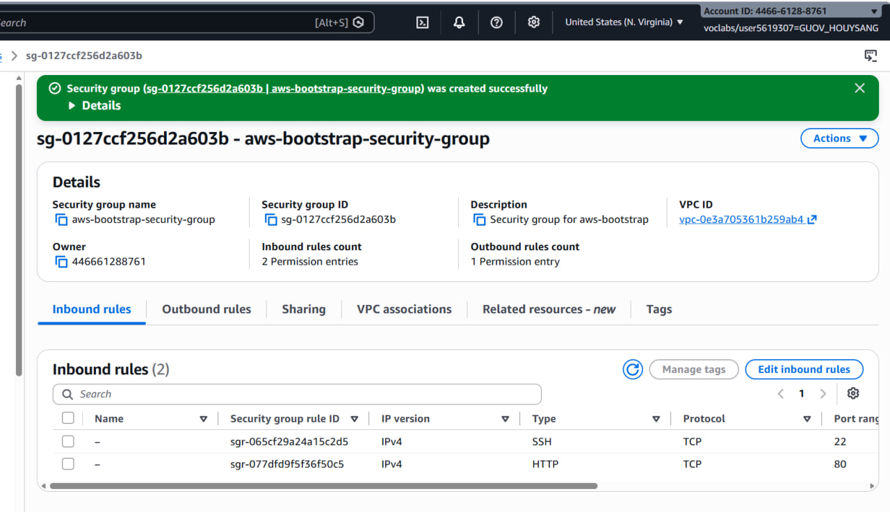
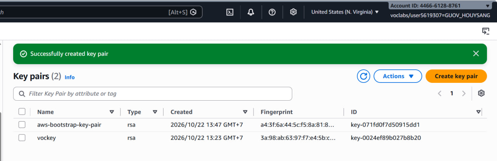
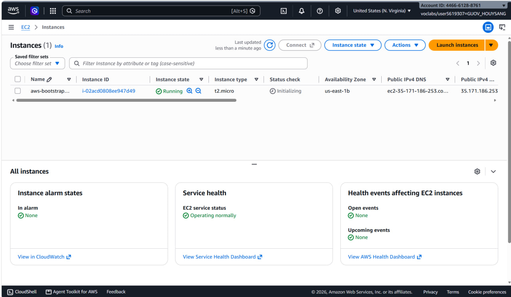
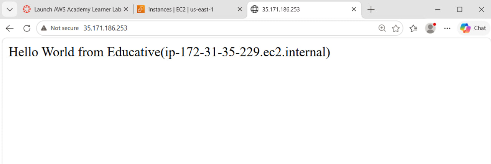
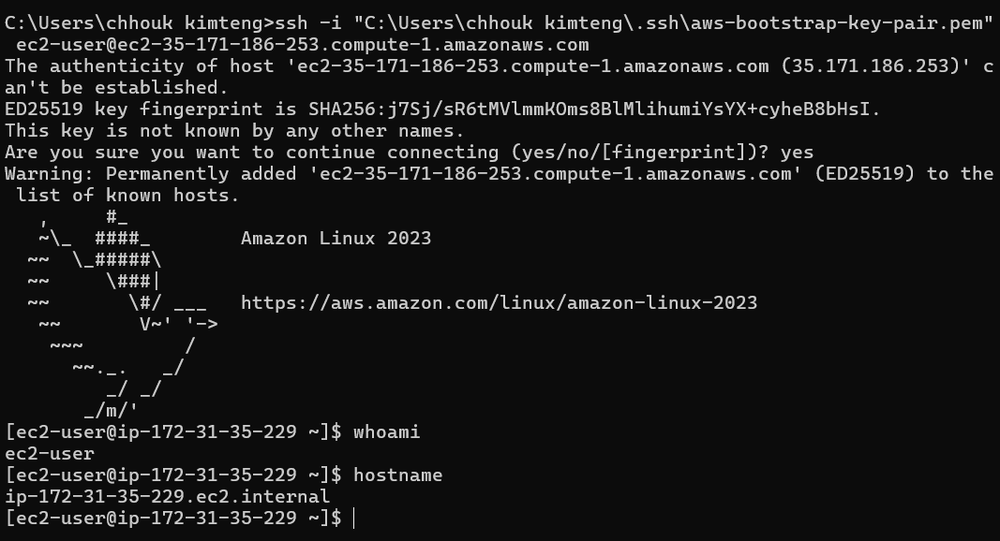
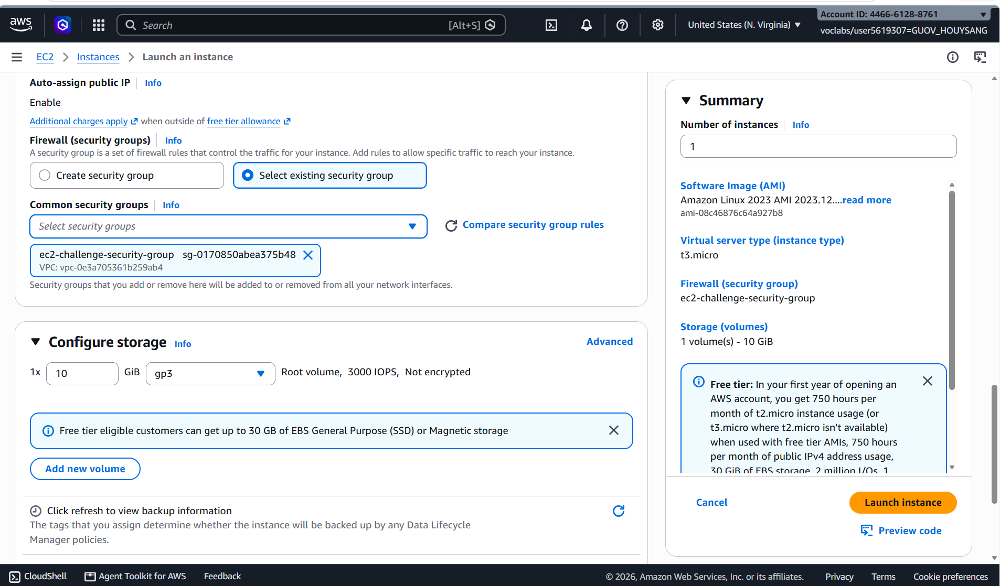
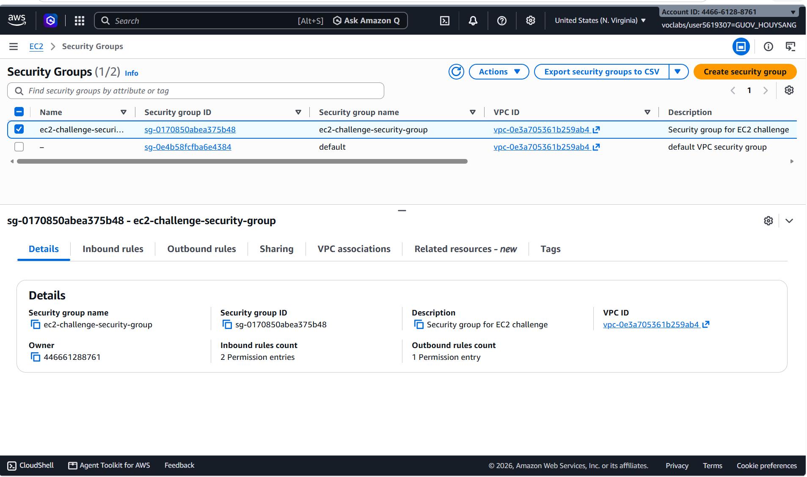
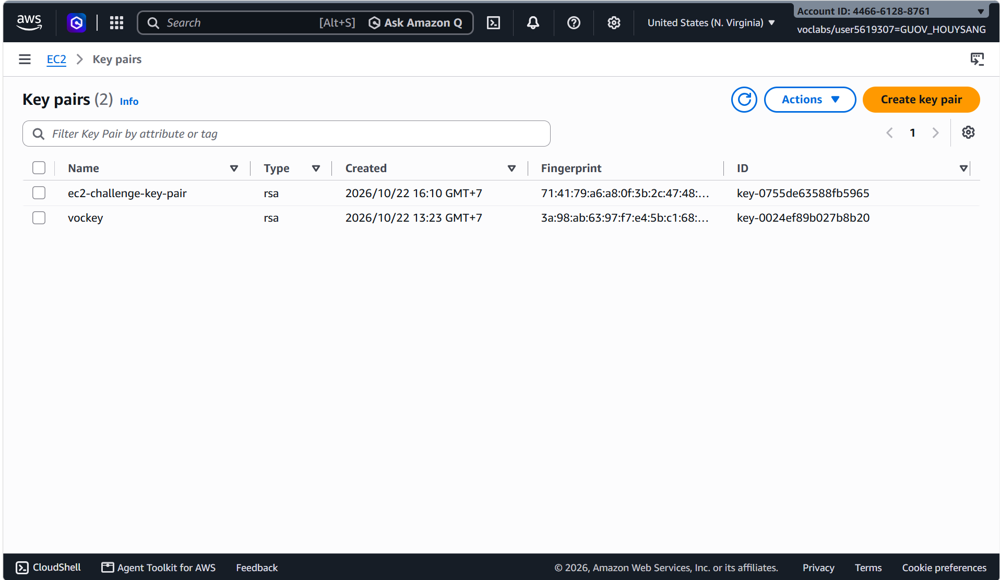
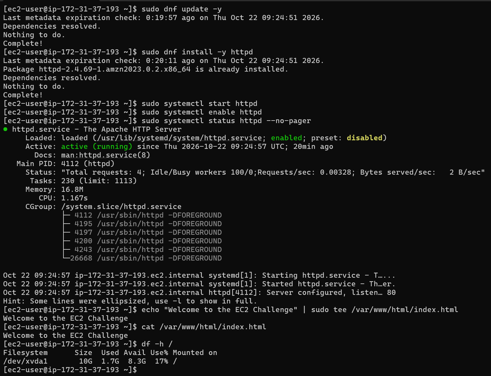
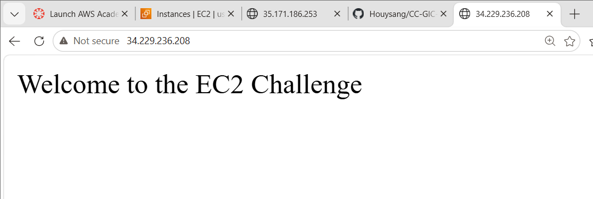

# Cloud Lab 1 Submission — Amazon EC2

- **Student name:** GUOV Houysang
- **Student ID:** e20220816
- **Learner Lab user name:** GUOV_HOUYSANG
- **Date completed:** October 22, 2026

---

## Part 1.1 — An Amazon EC2 Walkthrough

### Security group



### Key pair



### Instance details



### Browser test



### SSH connection



Did you connect with your own SSH client or with EC2 Instance Connect?

I connected with my own SSH client (using the downloaded `.pem` key file) rather than using EC2 Instance Connect.

---

## Part 1.2 — EC2 Web Solution (Challenge)

### Launch configuration



### Security group



### Running instance



### Commands on the instance



**Commands executed on instance:**
```bash
sudo dnf update -y
sudo dnf install -y httpd
sudo systemctl start httpd
sudo systemctl enable httpd
sudo systemctl status httpd --no-pager
echo "Welcome to the EC2 Challenge" | sudo tee /var/www/html/index.html
cat /var/www/html/index.html
df -h /
```

### Browser test




---

## Questions

#### 1. Your security group has an SSH rule and an HTTP rule. What does each one let you do? What would stop working if you deleted the HTTP rule?

- The **SSH rule** (port 22) allows secure remote shell connections to the EC2 instance from your local machine, so you can log in and run commands.
- The **HTTP rule** (port 80) allows inbound HTTP web traffic, so visitors can access the web server hosted on the instance via a browser.
- If you deleted the **HTTP rule**, the web page would stop loading in the browser. You would no longer be able to access `http://<instance-ip>` — the browser request would time out or be rejected. SSH access would still work since that uses port 22, which is unaffected.

#### 2. In Part 1.1 you never logged in to install the web server. What installed it, and when did it run?

The web server (Apache/httpd) was installed automatically by the **EC2 User Data script**. User Data is a startup script that AWS runs automatically during the instance launch process, before the instance is ready for SSH connections. It ran at boot time as part of the initial instance provisioning — that is when the "Hello World from Educative" page was created and the web server was started.

#### 3. Why does the web page open with `http://` but not with `https://`?

The security group only has an **HTTP rule (port 80)** open — there is no **HTTPS rule (port 443)**. Additionally, no SSL/TLS certificate has been configured on the web server. HTTPS requires both: (a) the security group to allow inbound traffic on port 443, and (b) an SSL/TLS certificate installed and configured on the web server (e.g., Apache virtual host configured for SSL). Since neither is set up, `https://` fails while `http://` works.

#### 4. Part 1.2 asked for a 10 GiB root volume. Where in the launch settings did you set it, and how can you check the size on the running instance?

- **Where set:** The 10 GiB root volume size was configured in the **Storage** section of the launch wizard (Step 4: "Add Storage" / "Configure storage"). The default root volume (`/dev/xvda` or `/dev/sda1`) was set to 10 GiB with the "Delete on termination" flag enabled.
- **How to check on running instance:** You can verify the volume size by running `df -h /` in the terminal on the instance. This shows the total and available disk space. Alternatively, `lsblk` lists block devices and their sizes. In the AWS EC2 console, you can also check under **EC2 > Volumes** for the attached EBS volume and its size.

## Problems and how I solved them (optional)

No significant problems were encountered during this lab. All instances launched and connected successfully on the first attempt.

## AI note (optional)

One suggestion an AI tool gave you and how you checked it.

## Clean up

- [ ] Part 1.1: instance terminated, key pair and security group deleted.
- [ ] Part 1.2: instance terminated, security group (and key pair, if any) deleted.