# Cloud Lab 2 Submission — Load Balancer and Auto Scaling

- **Student name:** GUOV Houysang
- **Student ID:** e20220816
- **Learner Lab user name:** GUOV_HOUYSANG
- **Date completed:** November 3, 2026

---

## Security groups

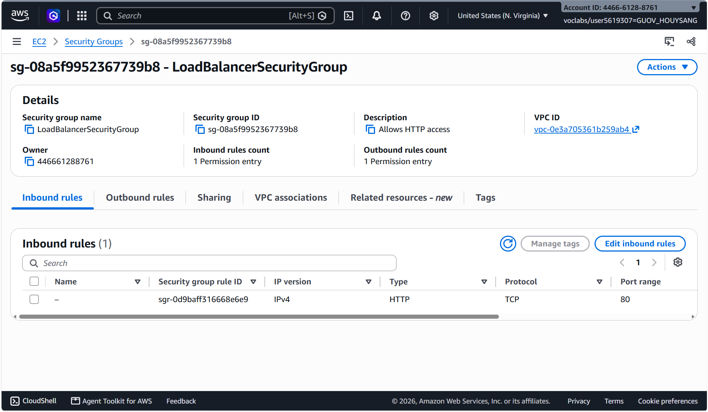

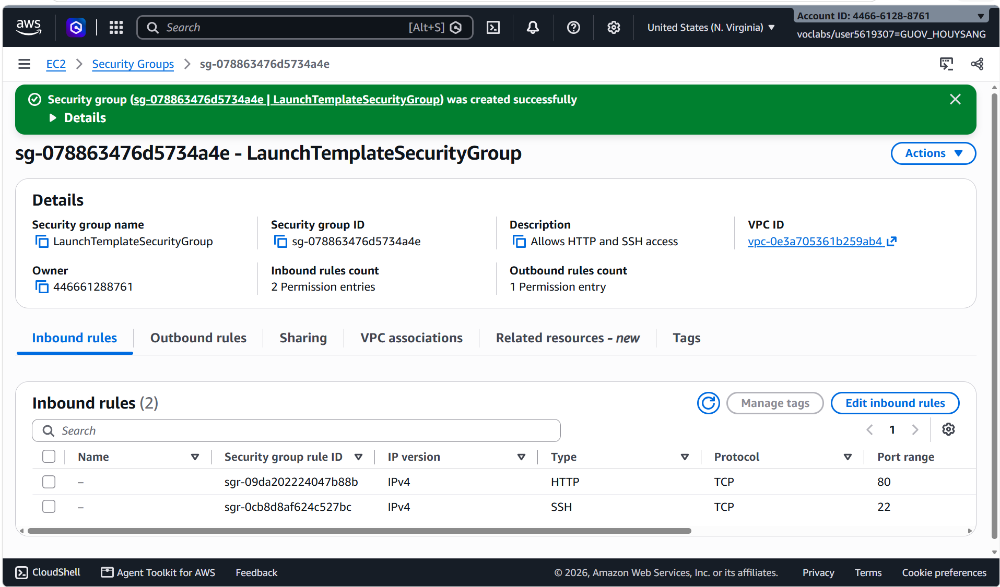

## Target group

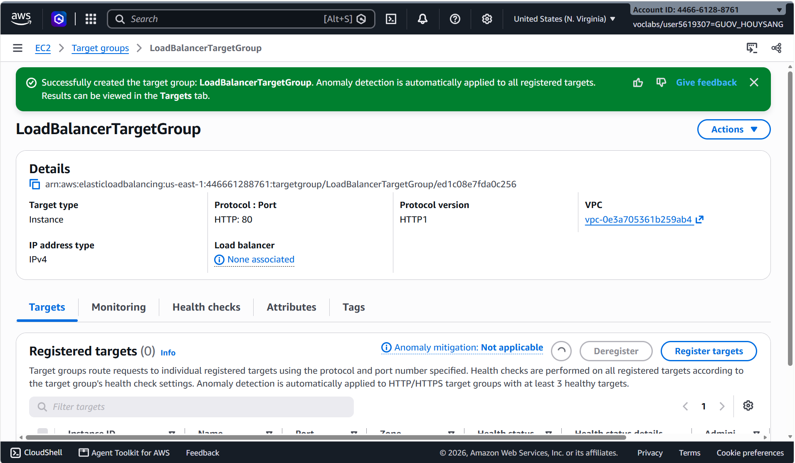

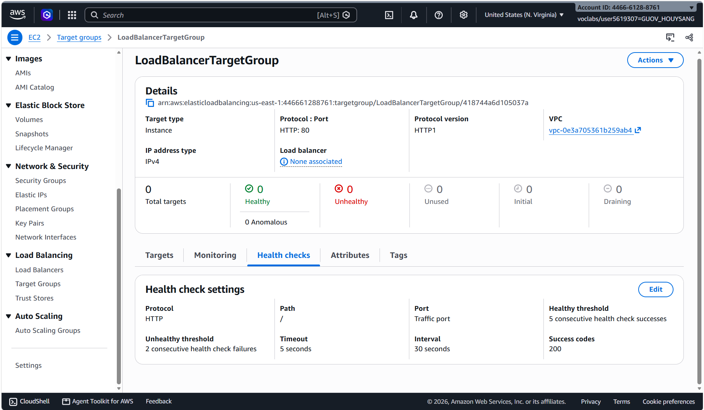

## Application Load Balancer

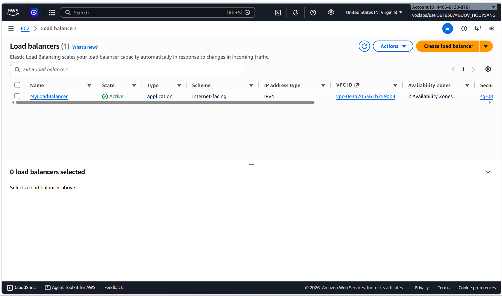

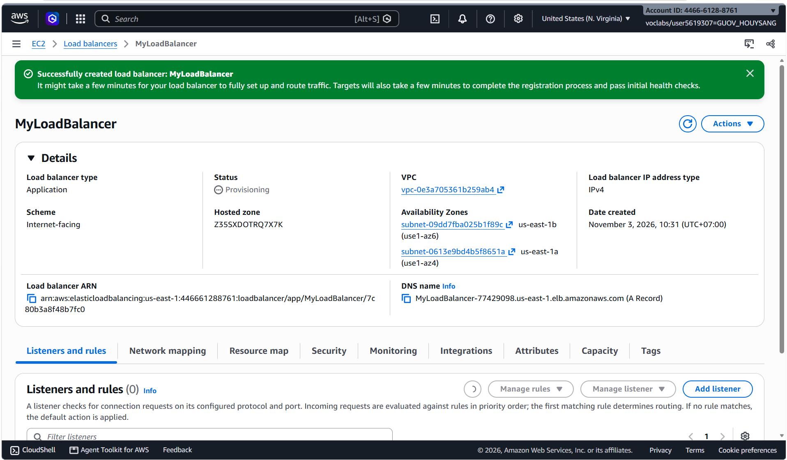

## Launch template

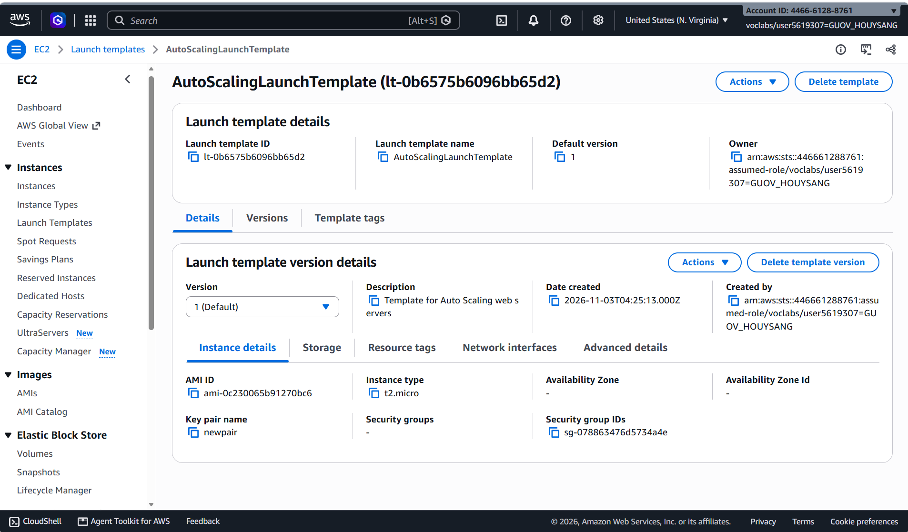

## Auto Scaling group

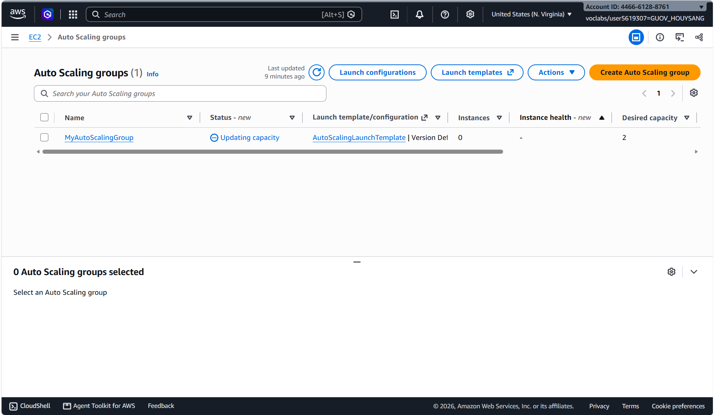

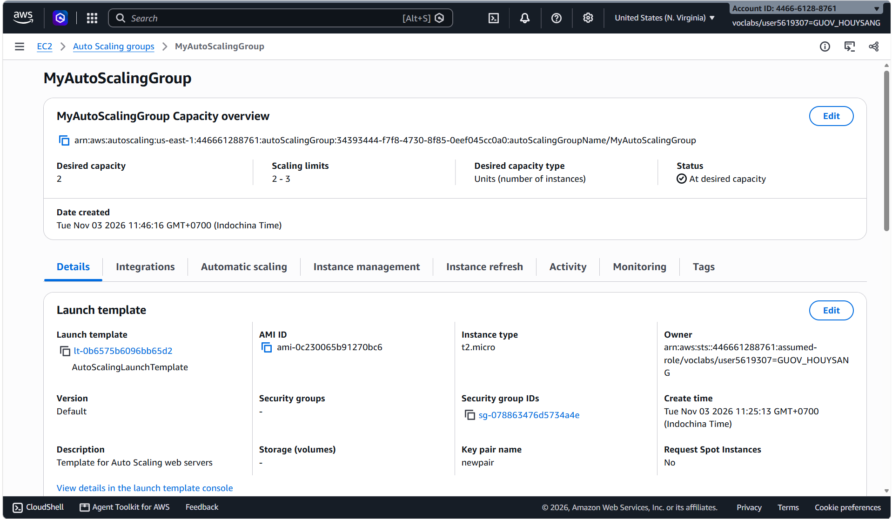

## Load balancing test

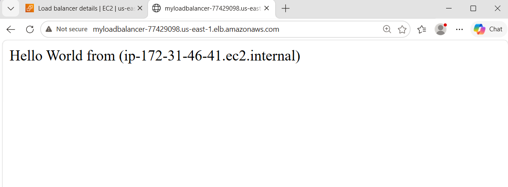

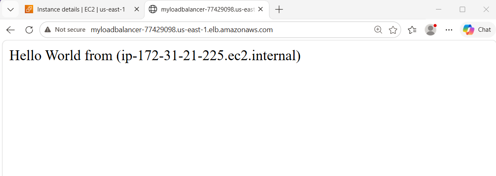

## Simulated application failure

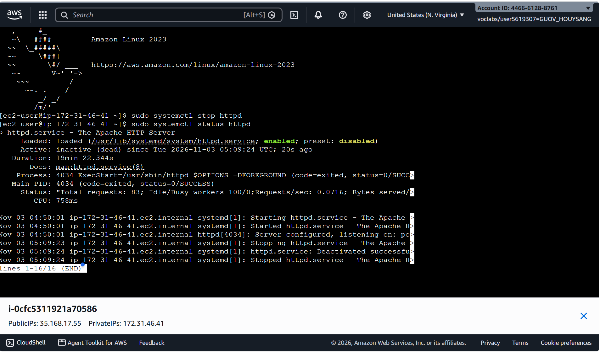

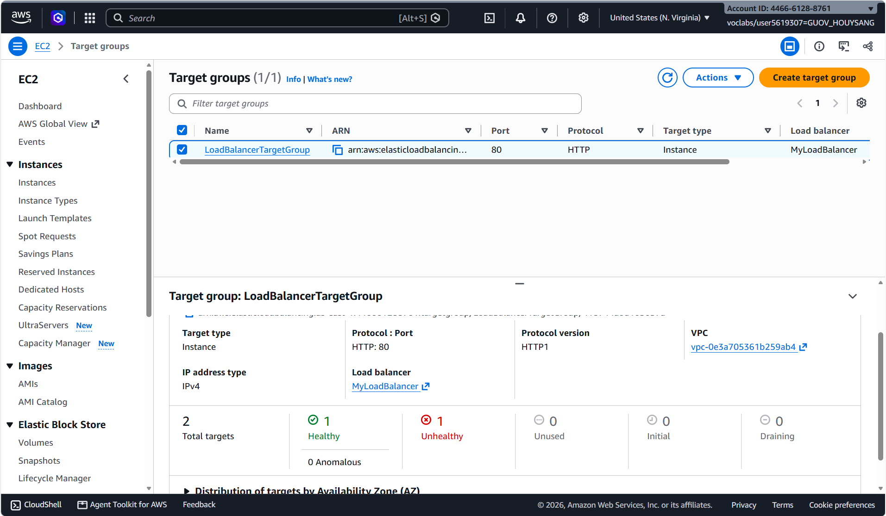

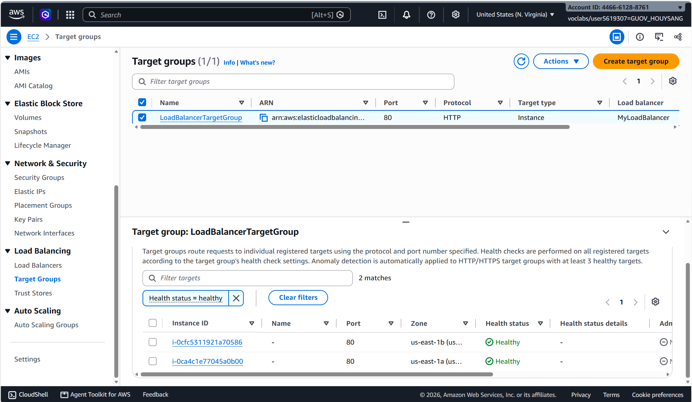

About how many minutes passed between stopping `httpd` and the new instance becoming healthy?

I stopped `httpd` on `ip-172-31-46-41` at 05:09:24 UTC. The new instance became healthy about **5 minutes later**, including health check detection, instance replacement, and startup time.

---

## Questions

#### 1. Why does the page show a different host name when you refresh it?

Each page shows the private host name of the instance that served it. The Application Load Balancer sends each new request to one of the healthy targets in `LoadBalancerTargetGroup` (round robin by default). Because the Auto Scaling group runs two instances, one refresh can go to `ip-172-31-46-41` and the next to `ip-172-31-21-225`. The DNS name in the browser stays the same.

#### 2. After you stopped `httpd`, the instance was still *running* in EC2, but the target group marked it *unhealthy*. What did the health check test, and why did the instance fail it?

The health check sends an **HTTP GET request to path `/` on port 80** every 30 seconds. It expects a **200** response within 5 seconds. The EC2 *running* state only shows that the virtual machine is on. It says nothing about the application. After `httpd` was stopped, nothing was listening on port 80, so the connection was refused. Each check failed, and after **2 failures in a row** (the unhealthy threshold) the target group marked the instance unhealthy and the load balancer stopped sending it traffic.

#### 3. Who replaced the failed instance: the load balancer, the target group, or the Auto Scaling group? Explain the role of each one.

The **Auto Scaling group** replaced it.

- **Load balancer (`MyLoadBalancer`):** The single entry point for users. It listens on HTTP port 80 and forwards requests to the target group, sending them only to healthy targets. It does not create or delete instances.
- **Target group (`LoadBalancerTargetGroup`):** Holds the list of registered instances and runs the health checks on them. It decides which targets are healthy or unhealthy, but it cannot launch or terminate instances.
- **Auto Scaling group (`MyAutoScalingGroup`):** Keeps the desired number of instances running. ELB health checks are turned on for the group, so it uses the target group's result. When an instance is unhealthy, it terminates that instance and launches a new one from `AutoScalingLaunchTemplate`. It then registers the new instance in the target group.

#### 4. With desired 2, minimum 2 and maximum 3, how many instances run normally? In what situation could there be 3?

Normally **2** instances run, because the Auto Scaling group keeps the count at the desired capacity. There could be **3** in these cases:

- A scaling policy (for example, target tracking on average CPU) raises the desired capacity because of high load. The group can add one more instance, up to the maximum of 3.
- Someone manually sets the desired capacity to 3.
- For a short time during a replacement or instance refresh, the new instance starts before the old one finishes terminating. The maximum of 3 leaves room for that.

#### 5. The instances' security group allows HTTP from anywhere. How could you change it so that the instances accept HTTP **only** from the load balancer?

Edit the inbound rules of `LaunchTemplateSecurityGroup`. Change the HTTP (port 80) rule's source from `0.0.0.0/0` to **the load balancer's security group** (`LoadBalancerSecurityGroup`, selected by its `sg-…` ID). After that, only traffic coming from the load balancer is allowed on port 80. A user who opens an instance's public IP directly is blocked, but the load balancer and its health checks still reach the instances. You should also limit or remove the SSH rule (port 22), for example to only your own IP.

## Problems and how I solved them (optional)

No major problems. The target group showed "None associated" for the load balancer until the load balancer was created with a listener that forwards to `LoadBalancerTargetGroup`. After that, the targets registered by the Auto Scaling group showed up and became healthy.

## AI note (optional)

An AI tool suggested that I could improve security by allowing HTTP traffic to the EC2 instances only from the load balancer's security group. I checked this suggestion against the AWS documentation for Application Load Balancer security groups and confirmed that AWS recommends this configuration.

## Clean up

- [x] `MyAutoScalingGroup` deleted and its instances terminated.
- [x] `AutoScalingLaunchTemplate` deleted.
- [x] `MyLoadBalancer` and `LoadBalancerTargetGroup` deleted.
- [x] Both security groups deleted.
