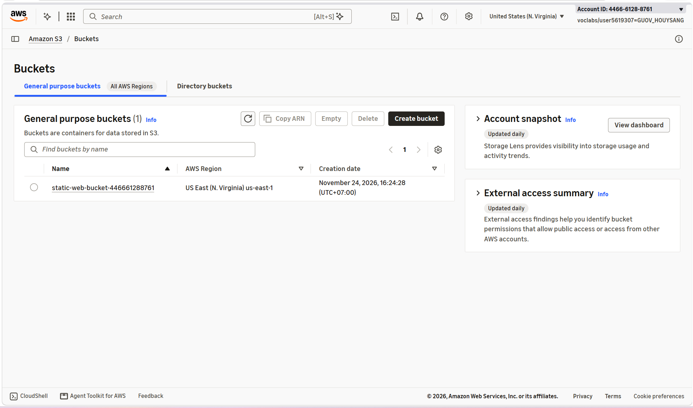
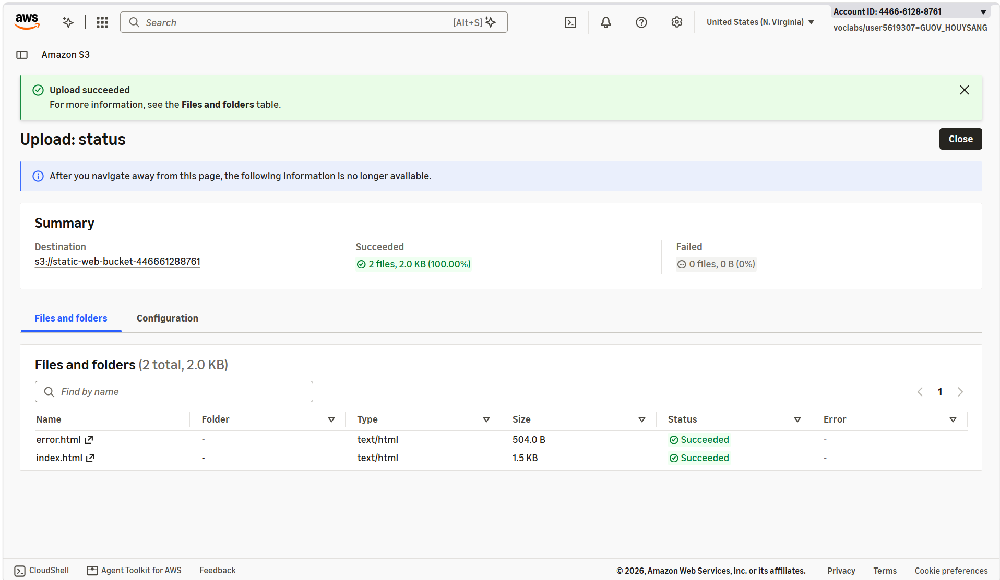
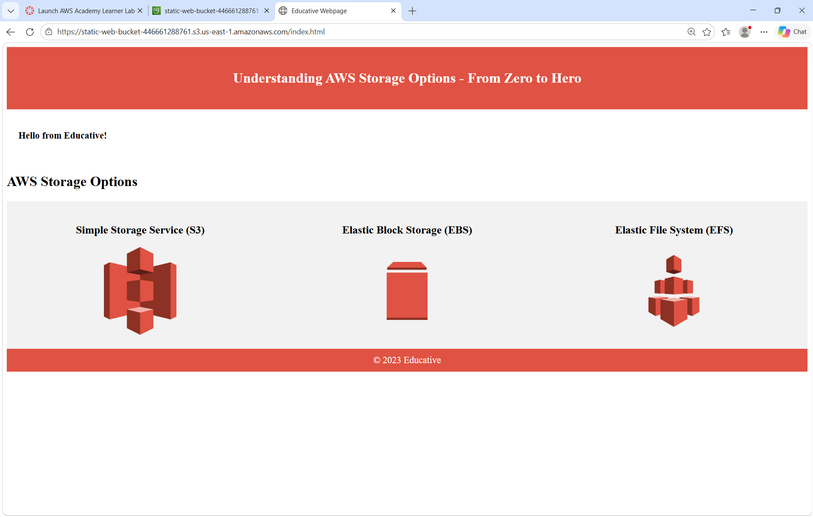
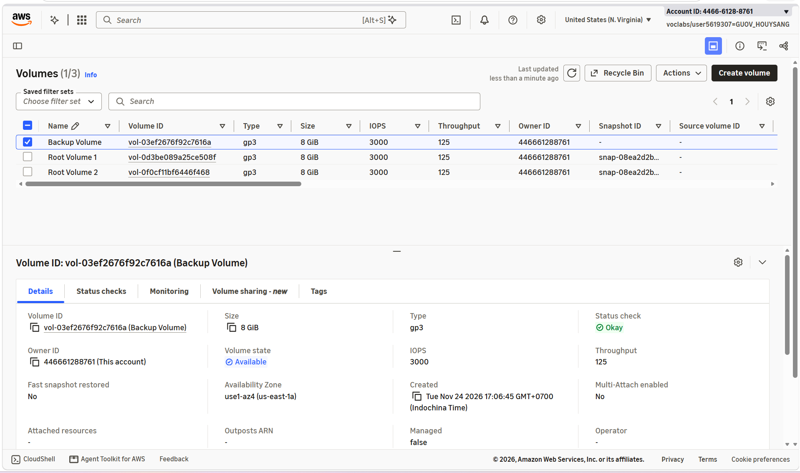
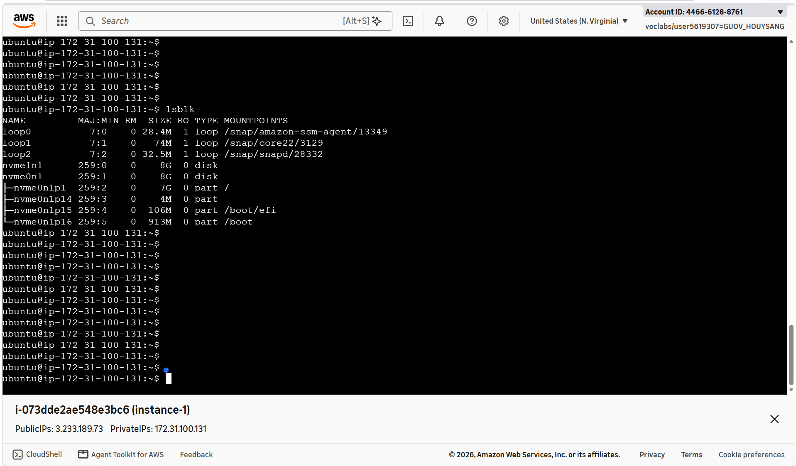
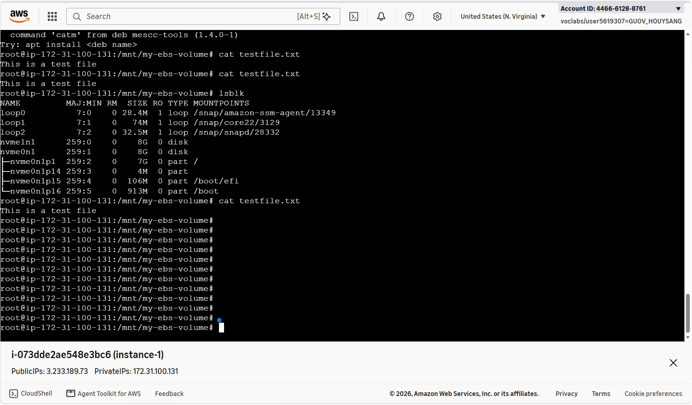
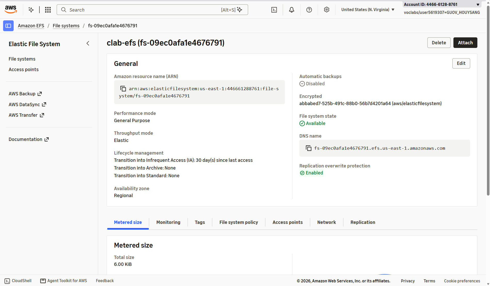
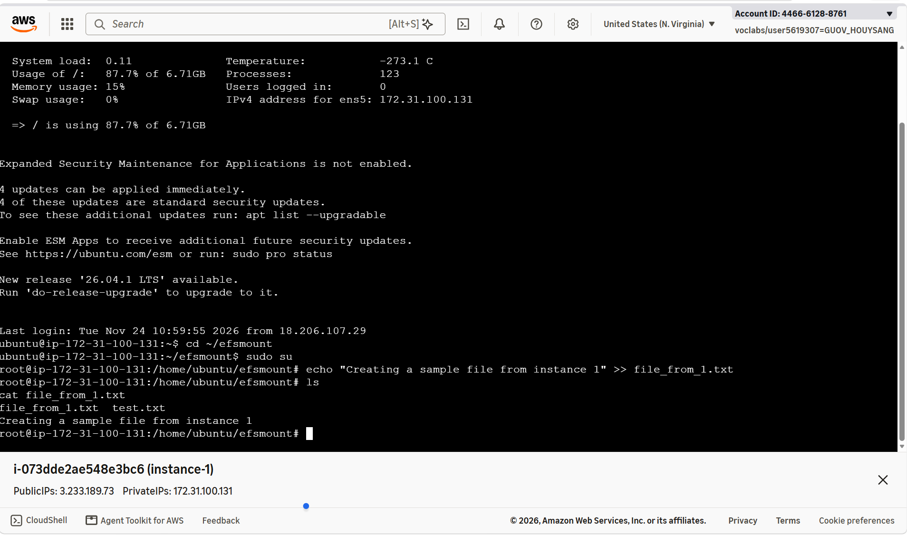
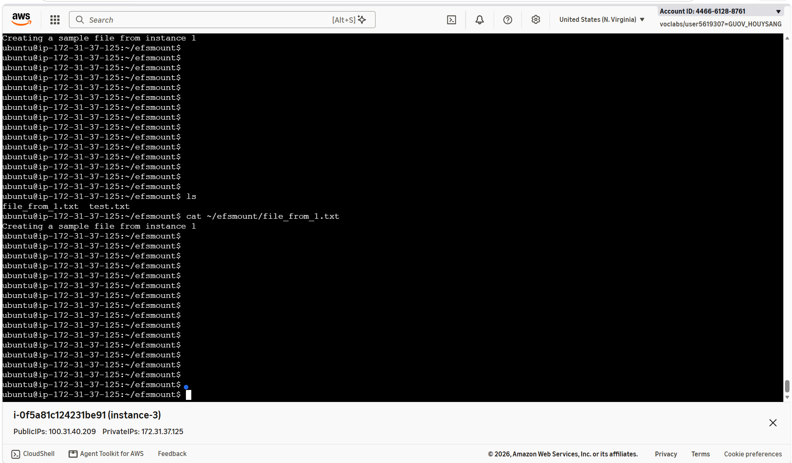

# Cloud Lab 3 Submission — AWS Storage Options

- **Student name:** GUOV Houysang
- **Student ID:** e20220816
- **Learner Lab user name:** GUOV_HOUYSANG
- **Date completed:** November 24, 2026

---

## Part 2.1 — Amazon S3

### Bucket list

### Uploaded files

### Static website

---

## Part 2.2 — Amazon EBS

### Volumes page

### Attached volume (`lsblk`)

Which device name did your volume get (`xvdf`, `nvme1n1`, ...)?

### File read on instance-2

---

## Part 2.3 — Amazon EFS

### File system and mount targets

### File created on instance-1

### File listed on instance-3

---

## Questions

### 1. Why did the static website endpoint first return 403 Forbidden?

The endpoint returned **403 Forbidden** because public access to the bucket objects was not allowed. Enabling static website hosting alone does not make the files publicly accessible.

After I added the bucket policy allowing everyone (`Principal: "*"`) to perform `s3:GetObject`, visitors could access the website files. The website then displayed the `index.html` page.

### 2. What would have happened to a file saved on instance-1's root volume after terminating instance-1?

The file would normally have been deleted because an EC2 instance's root EBS volume is configured to be deleted when the instance is terminated.

However, `Backup Volume` is an additional EBS volume that exists independently of the instance. Therefore, its data remained available when I moved it to instance-2.

### 3. Why did you run `mkfs` on instance-1 but not on instance-2?

I ran `mkfs` on instance-1 because `Backup Volume` was a new, empty volume without a file system. The command created an ext4 file system so Linux could store files on it.

I did not run `mkfs` again on instance-2 because the volume already had a file system and contained `testfile.txt`. Running `mkfs` again would have erased the existing data.

### 4. Why could instance-1 and instance-3 use EFS at the same time, while EBS had to be detached first? Why did they need to be in the subnets of the mount targets?

EFS is a shared network file system that allows multiple EC2 instances to access the same files at the same time through NFS.

EBS is block storage that is normally attached to one EC2 instance at a time. Therefore, I had to detach the volume from instance-1 before attaching it to instance-2.

The instances needed to be in subnets with EFS mount targets because the mount targets provide network access to the EFS file system. Each instance connects through a mount target in its Availability Zone.

### 5. Which storage service would you choose for each need?

| Need | Storage service | Reason |
|---|---|---|
| (a) A website's images | **S3** | S3 stores images as objects and allows them to be accessed over the internet. |
| (b) The disk of a database server | **EBS** | EBS provides persistent block storage that can be attached to an EC2 instance. |
| (c) A folder shared by several web servers | **EFS** | EFS allows multiple servers to access the same shared file system at the same time. |

## Problems and How I Solved Them

During this lab, I had some difficulties installing the EFS client because instance-3 ran out of disk space.

I solved this problem by removing unnecessary build files and following the installation steps again. I also checked the EFS mount and shared files to make sure everything worked correctly.

---

## AI Note

An AI tool suggested removing the build folder `~/efs-utils/src/target` to free up disk space. I checked the disk usage and confirmed that the installation worked after removing the unnecessary files.

## Clean up

- [x] Instances `instance-1`, `instance-2`, `instance-3` terminated.
- [x] `clab-efs` and **Backup Volume** deleted.
- [x] Security groups `efs-sg` and `ec2instances-sg` deleted.
- [x] S3 bucket emptied and deleted.