# Cloud Lab 4 Submission — Amazon VPC

- **Student name:** GUOV Houysang
- **Student ID:** e20220816
- **Learner Lab user name:** GUOV_HOUYSANG
- **Date completed:** November 11, 2026

---

## VPC and internet gateway

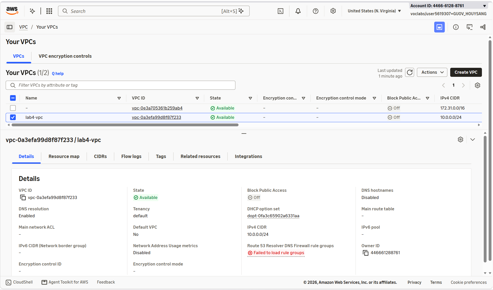

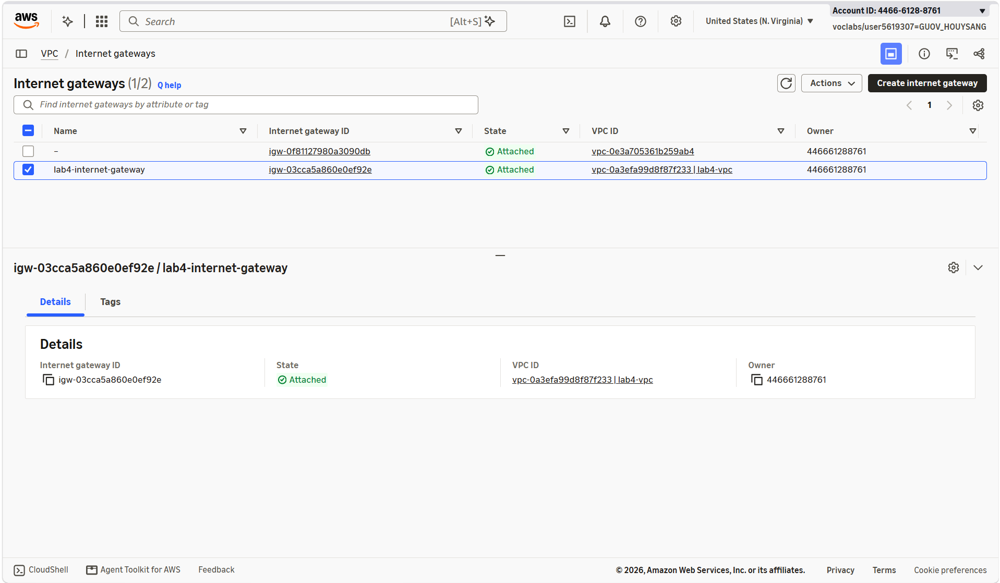

## Public subnet

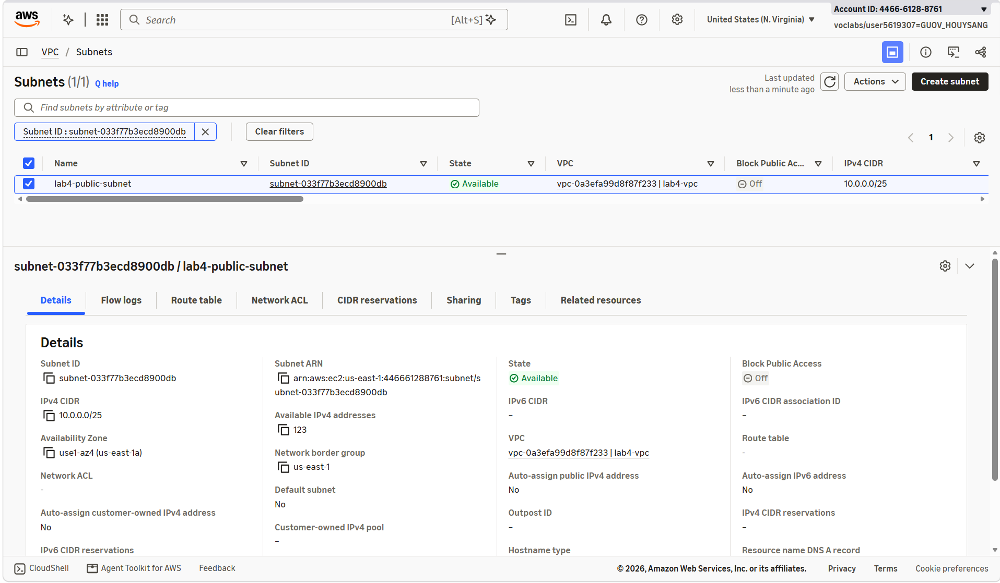

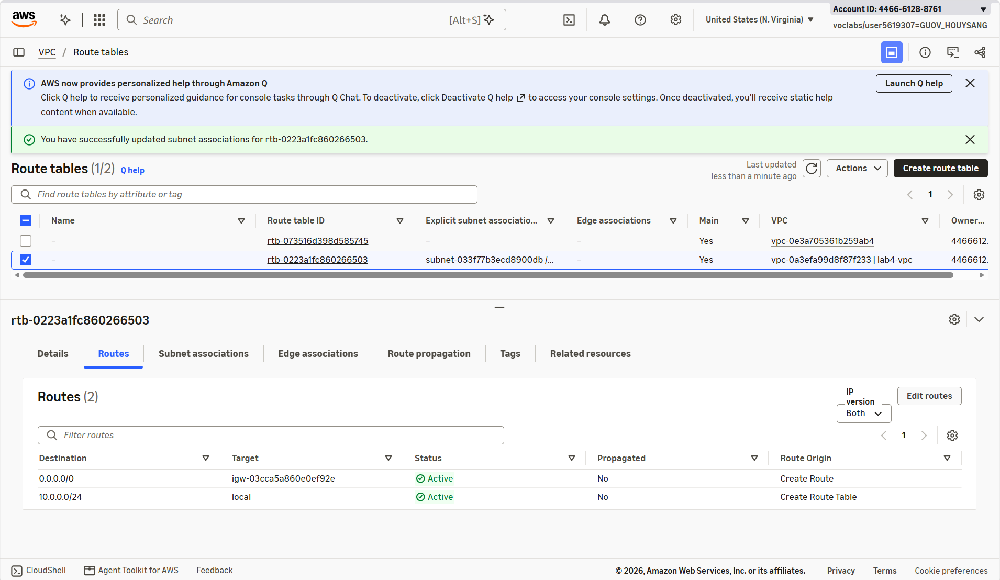

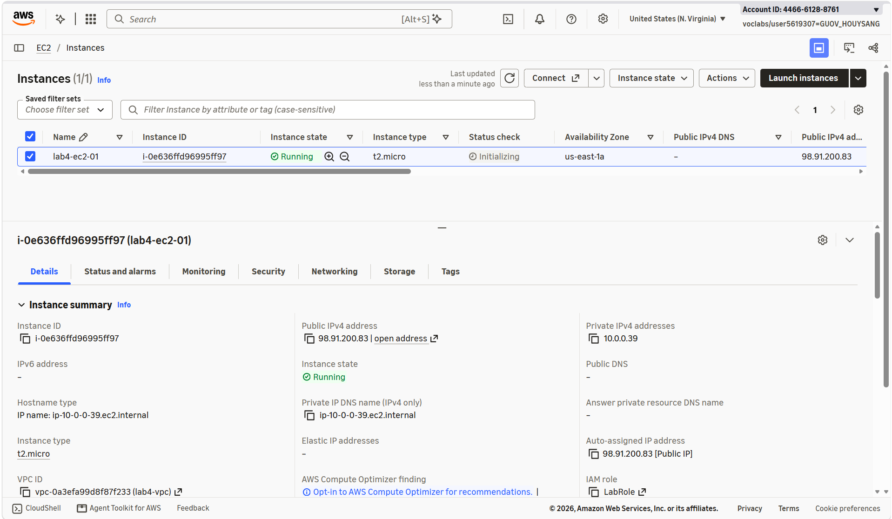

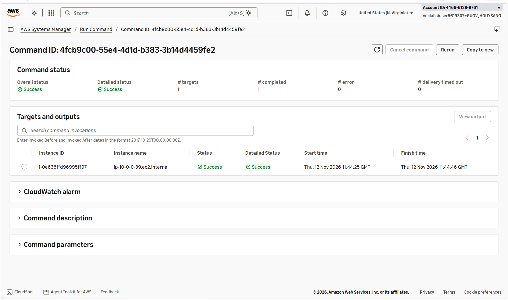

## Private subnet

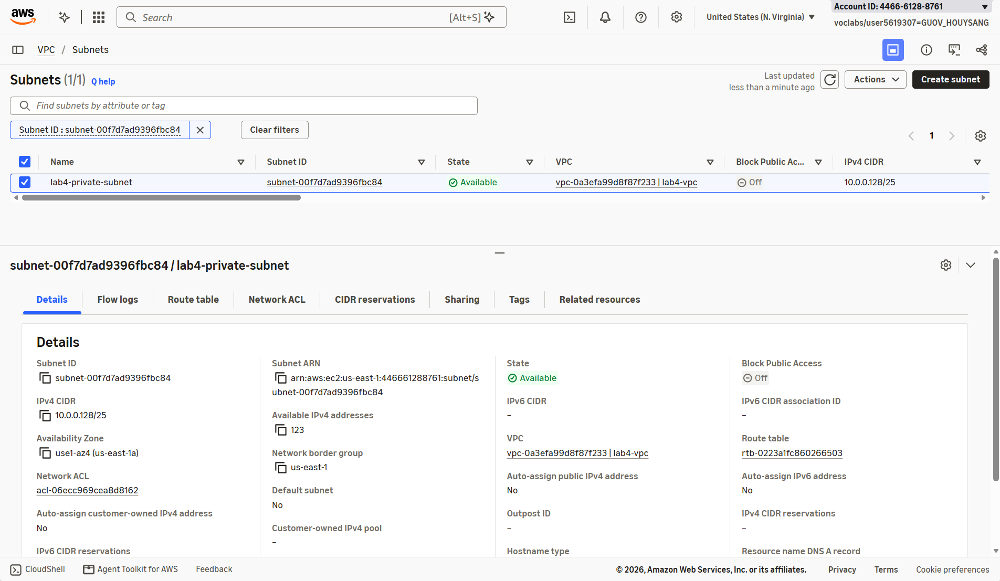

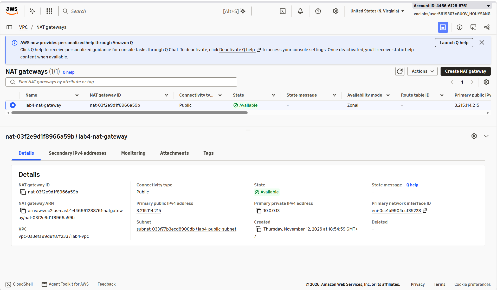

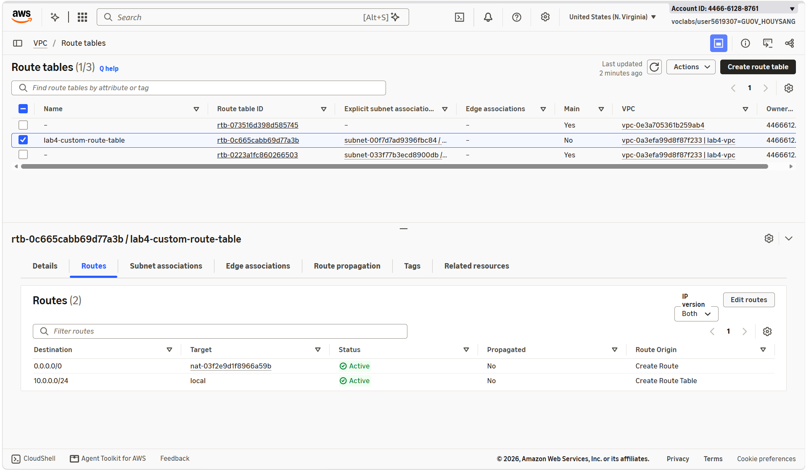

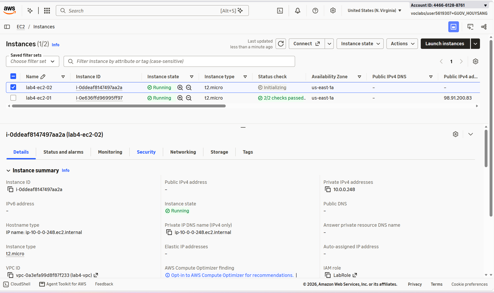

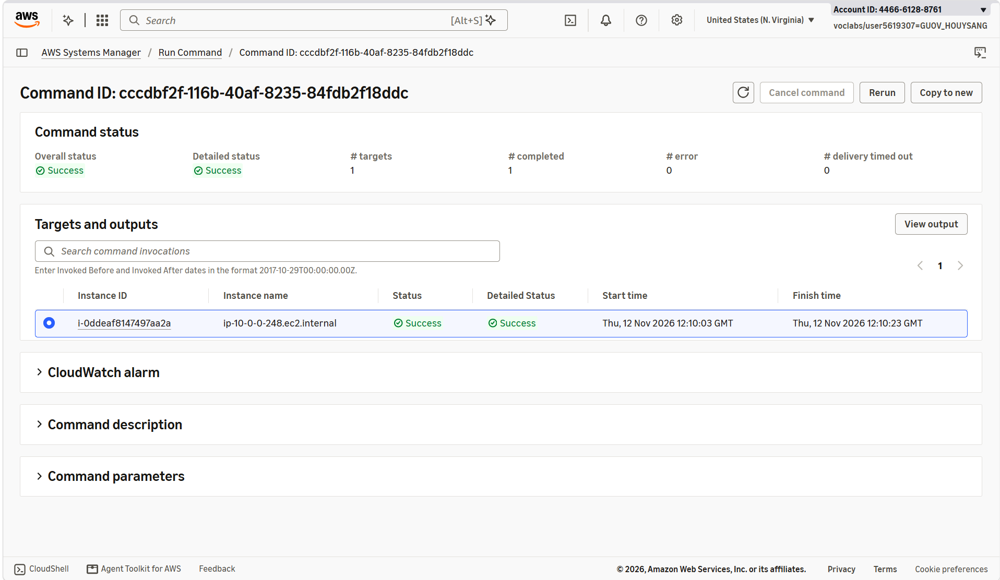

---

## Questions

### 1. The VPC is `10.0.0.0/24` and the subnets are `10.0.0.0/25` and `10.0.0.128/25`. How many IP addresses does each block contain, and why do the two subnets not overlap?

Each `/25` subnet contains 128 IP addresses. AWS reserves 5 IP addresses in each subnet, leaving 123 available IP addresses.

The two subnets do not overlap because they use different IP address ranges. The first subnet uses `10.0.0.0` to `10.0.0.127`, while the second subnet uses `10.0.0.128` to `10.0.0.255`.

Together, they cover the entire VPC range of `10.0.0.0/24`.

### 2. Both subnets are in the same VPC. What exactly makes `lab4-public-subnet` public and `lab4-private-subnet` private?

The public subnet is public because its route table has a route to the Internet Gateway (`0.0.0.0/0`).

The private subnet does not have a direct route to the Internet Gateway. Instead, its route table sends internet traffic to the NAT Gateway.

### 3. Why is the NAT Gateway placed in the public subnet and not in the private one?

The NAT Gateway needs access to the Internet Gateway to communicate with the internet.

Therefore, it is placed in the public subnet and uses an Elastic IP address. Private instances can use it to access the internet without having their own public IP addresses.

### 4. `lab4-ec2-02` has no public IP address. Can someone on the internet open a connection to it? Can it download updates? Explain both answers.

No, someone on the internet cannot directly open a connection to `lab4-ec2-02` because it does not have a public IP address.

However, it can download software updates through the NAT Gateway. The NAT Gateway allows outgoing internet connections from the private subnet but does not allow unsolicited incoming connections from the internet.

### 5. You tested internet access with Systems Manager instead of SSH. Why did the instances need `LabInstanceProfile` for this?

The instances needed `LabInstanceProfile` to receive AWS permissions for Systems Manager.

The profile allows the Systems Manager Agent on the EC2 instances to communicate with the Systems Manager service. This lets us manage the instances and run commands without connecting through SSH.

---

## Problems and How I Solved Them

During this lab, I had some difficulties finding the correct settings in the AWS Console, especially in Systems Manager and when creating the NAT Gateway.

I solved these problems by following the instructions step by step and checking the resource settings before continuing.

I also learned to check the correct VPC, subnet, route table, and gateway before deleting resources.

---

## AI Note

An AI tool suggested using a NAT Gateway in the public subnet to allow the private EC2 instance to access the internet without a public IP address. I checked this suggestion against the AWS documentation for NAT Gateways and confirmed that it is correct.

---

## Clean up

- [x] Instances terminated.
- [x] NAT gateway deleted and its Elastic IP released.
- [x] Internet gateway detached and deleted.
- [x] `lab4-vpc` deleted.